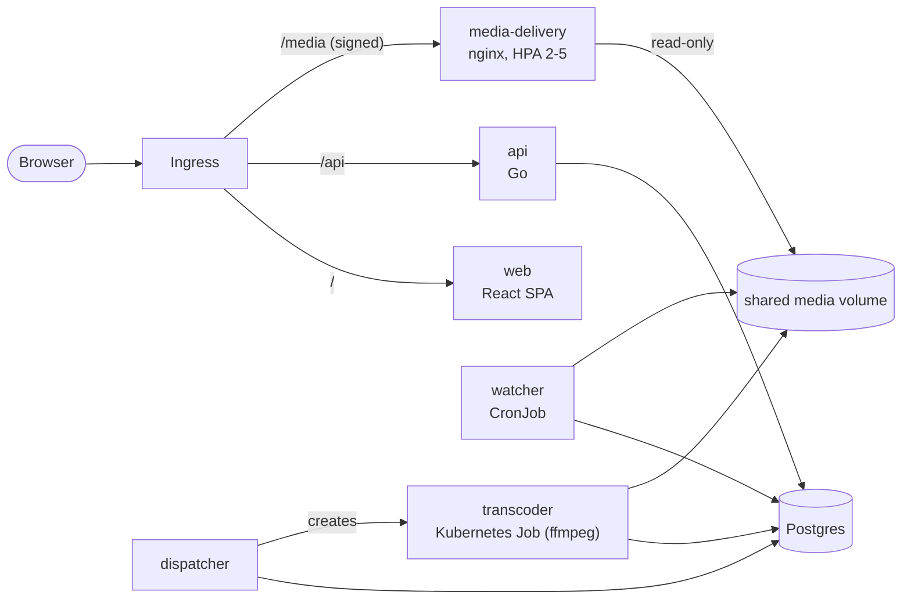
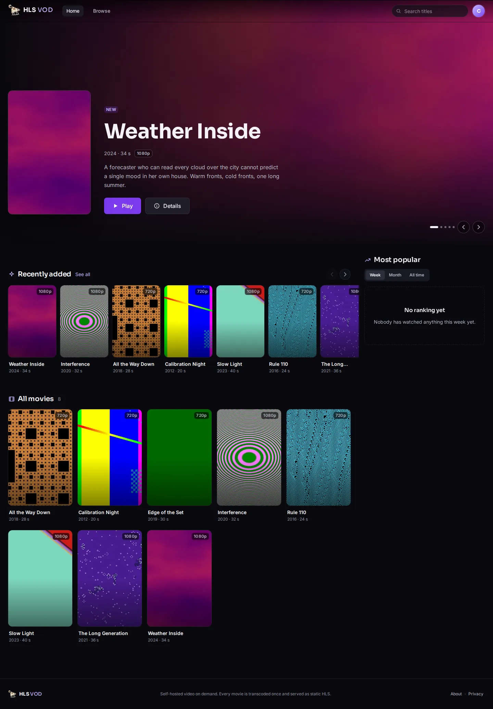
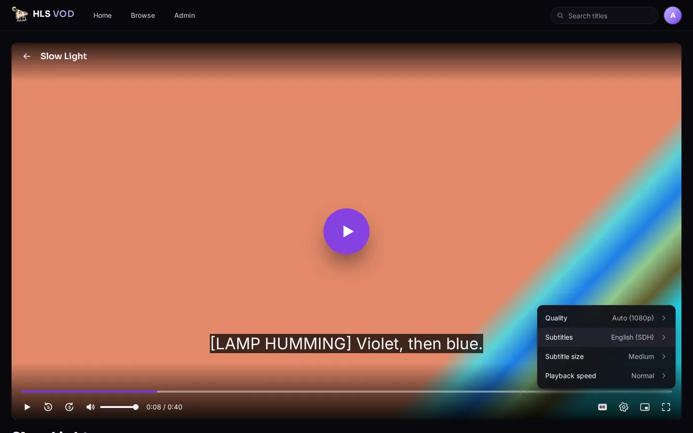
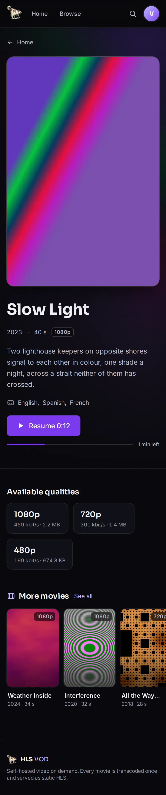

# hls-vod

A self-hosted **HLS video-on-demand** platform. Movies are transcoded to adaptive HLS once, at
ingest; playback is static files served by a stateless nginx tier to holders of a URL the API
signed. All state lives in Postgres, so everything else scales and restarts freely.







<p align="center"></p>

Screenshots show only the synthetic demo movies `make demo-seed` generates.

## Features

- **Ingest pipeline:** drop a file in `inbox/` and it is claimed, queued and transcoded into an
  adaptive HLS ladder. The top rung is a remux when the codec allows; the source is never
  upscaled. A backdrop frame, seek-preview thumbnail sprites and subtitles are produced in the
  same run.
- **Playback:** hls.js with adaptive bitrate, seek previews, and resume where you left off
  ("continue watching"). Icon-only controls with tooltips, ±5 s skips whose on-screen bubble adds
  up, a volume slider, a settings menu (quality, subtitles, subtitle size, speed), keyboard
  shortcuts, double-tap to skip on touch screens, picture-in-picture. Subtitles from the source
  file, signed like the video. Expired media URLs are renewed mid-movie, without interrupting
  playback.
- **Your own name:** the product's name is configuration (`VITE_BRAND_NAME`, `SITE_NAME`), not
  code.
- **Browsing:** a dark, responsive interface with one design system (tokens, self-hosted
  fonts, inline icons): a home page with a rotating spotlight of featured movies, continue
  watching, recently added and a "most popular" ranking by distinct viewers (week, month, all
  time); portrait poster cards with responsive `srcset`; a detail page with the poster over the
  movie's blurred frame. Keyboard reachable, reduced-motion aware, WCAG AA contrast.
- **Catalog:** search, sort and year filters, all in the URL.
- **About and privacy:** a public About page with a plain-language privacy section (what is
  stored, the one login cookie, the outside services), written in Markdown and turned into data
  at build time: no Markdown library in the bundle, no raw HTML.
- **Accounts:**
  - open registration with email verification (Resend) and a Cloudflare Turnstile challenge;
  - forgot / reset password;
  - sign in with Google (OIDC, PKCE);
  - an account page with password change and per-device sessions ("sign out everywhere
    else").
- **Admin area:**
  - users: disable, role; never zero admins;
  - transcode jobs with their errors;
  - movies: retry a failed one, delete, retranscode a ready movie into a new version
    without downtime, edit title, year and overview, feature it on the home page;
  - posters: upload an image (JPEG, PNG or WebP; type read from the bytes, size checked
    before decoding), cropped to 2:3 and resized to three JPEG widths, stored in Postgres and
    served by signed URLs (see ADR 0010);
  - publishing: viewers see a movie only once it is ready, has a poster and a description,
    a rule the database itself enforces with a CHECK constraint.

## Backend highlights

- **No live transcoding, ever:** playback costs nginx and bandwidth, not CPU.
- **Signed media URLs checked by nginx itself** (`secure_link_md5`, key last, token in the
  path so relative HLS URLs inherit it): the delivery tier never calls the API and holds no
  state.
- **Postgres as the job queue:**
  - the dispatcher claims jobs with an advisory lock + `FOR UPDATE SKIP LOCKED`, exact
    `MAX_CONCURRENT` across replicas;
  - transcoders run as Kubernetes Jobs, which only the dispatcher may create;
  - the database itself refuses a second active job per movie.
- **Crash-safe file work:**
  - the rename into `sources/` is the claim lock;
  - versions are written aside and published by one atomic rename and one transaction;
  - a failed `COMMIT` is re-read before any undo.
- **Sessions:**
  - refresh-token families with rotation and reuse detection;
  - 15-minute access tokens kept in memory only;
  - refresh serialised across browser tabs with a Web Lock.
- **Abuse resistance:**
  - login throttles per username+IP and per IP (password spraying), with in-flight
    reservations so parallel bursts cannot slip through;
  - the client IP is believed from `X-Forwarded-For` only through trusted proxies;
  - no email enumeration anywhere.
- **Security headers:** strict CSP with no inline scripts; Pod Security `restricted`; non-root
  read-only containers; no secrets in code, config or tests.

## Tech stack

| Area | Choice |
|---|---|
| Backend | Go (stdlib `net/http`), pgx/v5, goose, `log/slog`, Prometheus client, golang-jwt, go-oidc |
| Media | ffmpeg / ffprobe, HLS, nginx (`secure_link`) |
| Frontend | React, Vite, TypeScript, Tailwind CSS, hls.js, TanStack Query, openapi-typescript + openapi-fetch |
| Data | Postgres 16 |
| Platform | Docker, Kubernetes (Jobs, CronJob, HPA, NetworkPolicy), Kustomize, kind for a local cluster; Flux in progress |
| Quality | golangci-lint, gosec, govulncheck, gitleaks, testcontainers-go, vitest |

## Quick start

Needs Go, Docker, ffmpeg and Node 22+ (with corepack).

```bash
make setup                 # pinned dev tools, git hooks, web dependencies
cp .env.example .env       # then fill in the values (names only in the example; no defaults for secrets)
make db-up                 # Postgres in docker compose, on 127.0.0.1
make migrate
make user-add USER=admin ROLE=admin
make run                   # api on 127.0.0.1:8080
make media-up              # media-delivery on 127.0.0.1:8081
make web-dev               # http://127.0.0.1:5173
```

Put a movie in the catalog: drop it into `$MEDIA_ROOT/inbox/`, then run `make scan` (watcher)
and `make dispatch` (dispatcher with the local backend), or use `make dev-ingest
INPUT=movie.mp4 TITLE="My test"`. `make demo-seed` adds eight synthetic demo movies (ffmpeg test
sources and fractals, invented titles) to look around with.

The whole stack also runs on a local Kubernetes cluster: `make images && make kind-up`, then
`make kind-smoke` (kind and kubectl come with `make setup`; it uses 127.0.0.1:8080, so stop
`make run` first).

## Turning on registration and Google sign-in

Out of the box, accounts come only from `make user-add`. Registration and Google sign-in are
switched on with variables in `.env` (names in [.env.example](.env.example), which says what
each one does); `make run` reads them at start.

| Feature | `make run` (dev) | `make kind-up` | What you need |
|---|---|---|---|
| Registration + email verification, no outside account | `REGISTRATION_OPEN=true`, `MAIL_BACKEND=log`, `MAIL_FROM`, `PUBLIC_BASE_URL=http://127.0.0.1:5173`, `TURNSTILE_SITE_KEY` and `TURNSTILE_SECRET_KEY` set to Cloudflare's [test keys](https://developers.cloudflare.com/turnstile/troubleshooting/testing/) (the pair that always passes) | off | nothing: the mail, link included, is printed in the `make run` log instead of sent |
| Registration with real mail | as above, but `MAIL_BACKEND=resend` and `RESEND_API_KEY` | off | a [Resend](https://resend.com) API key and a sending domain; real Turnstile keys from the Cloudflare dashboard for a public site |
| Sign in with Google | `GOOGLE_CLIENT_ID`, `GOOGLE_CLIENT_SECRET`, `PUBLIC_BASE_URL` | off | your own OAuth client ("Web application") in the [Google Cloud console](https://console.cloud.google.com/apis/credentials), with the authorized redirect URI given in `.env.example` (`http://127.0.0.1:5173/api/v1/auth/google/callback` for `make web-dev`) |

With the first row: open http://127.0.0.1:5173/register (the Turnstile widget passes by itself
with the test keys), sign up, copy the `/verify-email#token=…` link from the api's log line
`mail not sent (MAIL_BACKEND=log)` into the browser, and you are signed in; logging in before
that is refused until the address is confirmed. `MAIL_FROM` needs single quotes in `.env`
(`MAIL_FROM='HLS VOD <noreply@example.com>'`), and the api accepts `MAIL_BACKEND=log` only on a
loopback address, which `make run` is. Never commit a key, not even a test one: `.env` is
gitignored.

**The kind cluster has all three off, on purpose.** `make kind-up` generates only random secrets
(database password, signing keys) and has no mail service, Turnstile keys or Google client, so its
overlay sets `MAIL_BACKEND=none` and `REGISTRATION_OPEN=false`, and Google stays off; you log in as
the `admin` it creates. [docs/architecture/physical.md](docs/architecture/physical.md#the-local-cluster-and-production)
lists what differs between the local cluster and production.

## Testing

```bash
make check
```

This runs build, vet, golangci-lint, every test (integration tests start their own Postgres
with testcontainers, so **Docker must be running**), gitleaks, govulncheck, gosec, and the
frontend checks (generated API types up to date, eslint, typecheck, vitest). External services
(Google, Resend, Turnstile) are faked in tests; no test uses a real credential.

## Documentation

- [docs/architecture/](docs/architecture/README.md): 4+1 views (logical, process, development,
  physical, scenarios) and ADRs
- [docs/openapi.yaml](docs/openapi.yaml): the API contract, validated by the handler tests and
  the source of the web client's types
- [CLAUDE.md](CLAUDE.md): the project's constraints and conventions

## AI-assisted development

This project was built with [Claude Code](https://claude.com/claude-code), working under the
constraints in [CLAUDE.md](CLAUDE.md):

- hard architectural rules;
- conventions enforced by lint;
- a definition of done.

Every change went through a pull request and had to pass `make check` before it was merged.
The behaviour each PR described was then checked by hand.
