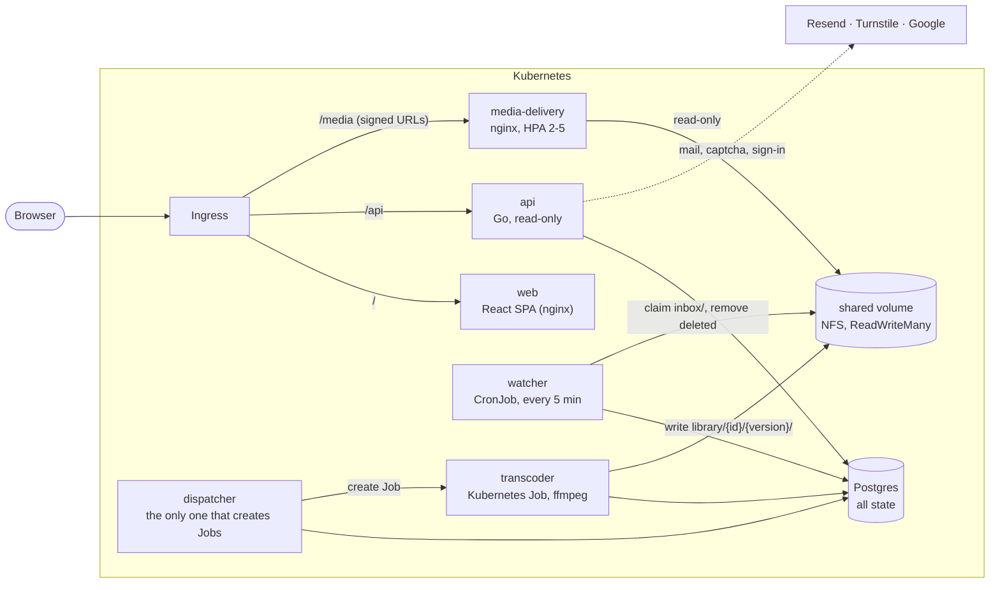

# Architecture

A self-hosted video-on-demand platform. Movies are transcoded to HLS once, at ingest; playback is
static files served by nginx to holders of a URL the api signed. All state lives in Postgres, so
every tier except Postgres is stateless and can be restarted or scaled freely.

This folder describes the system with the **4+1 view model**: four views, each for a different
reader, tied together by scenarios.

| View | Question it answers | For |
|---|---|---|
| [Logical](logical.md) | What are the domain objects, the services and their states? | anyone changing behaviour |
| [Process](process.md) | What runs at the same time, and what keeps it correct? | anyone touching concurrency |
| [Development](development.md) | How is the code organised, and which rules are enforced? | contributors |
| [Physical](physical.md) | Where does it run, and how does it scale? | operators |
| [Scenarios](scenarios.md) (+1) | How do the pieces work together, step by step? | everyone; the views are checked against these |
| [Decisions](decisions/) | Why is it built this way? | anyone about to change a decision |

The API contract is [`docs/openapi.yaml`](../openapi.yaml); handler tests validate every response
against it and the web client's types are generated from it.

## Overview

## How the views relate

- The **logical** view names the things (movies, jobs, users, sessions) and their states. The
  other views refer to them by those names.
- The **process** view takes the logical state machines and shows who moves them and how two
  movers never collide: row locks, advisory locks, `SKIP LOCKED`, in-flight reservations.
- The **development** view maps the logical services onto packages (`handler → service →
  store`) and lists the rules lint enforces so that the process guarantees hold (the api never
  touches files, only `mediapath` builds paths).
- The **physical** view places the processes: which are Deployments, which are Jobs, which are
  stateless and why that matters for probes and scaling.
- The **scenarios** walk through the most important flows end to end; each one exercises
  several views at once. The **decisions** record why the hard constraints are what they are.
