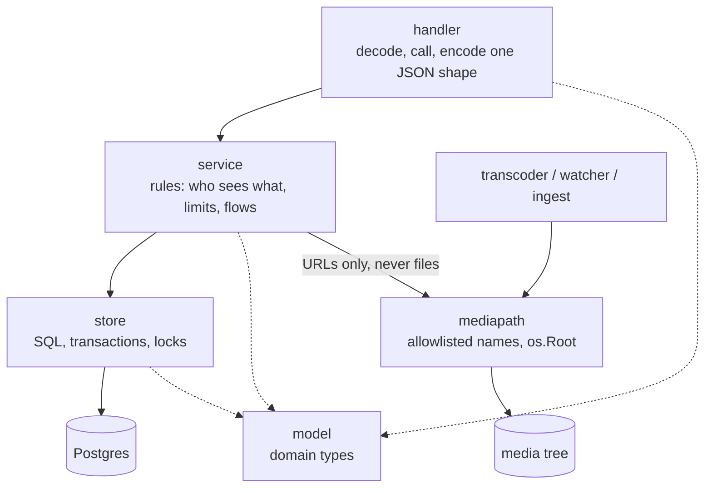

# Development view

How the code is organised, which rules are enforced by tooling rather than by convention, and
how a change is verified.

## Repository layout

One Go module at the root: binaries under `cmd/`, shared code under `internal/`. The SPA has its
own toolchain in `web/`.

```
cmd/
  api/          HTTP API
  dispatcher/   claims queued jobs, starts and watches transcoders
  transcoder/   --movie-id job mode; --input/--output for a manual run
  watcher/      one scan per run
  useradmin/    add / set-password / set-role / list (password never in argv or env)
internal/
  handler/      HTTP layer, thin
  service/      business rules
  store/        all SQL (pgx/v5)
  model/        domain types shared by the three layers
  config/       environment variables, fail fast
  auth/         argon2id, HS256 tokens, opaque tokens, throttle
  clientip/     the client address behind trusted proxies
  mediapath/    the only place that turns untrusted names into paths
  medialayout/  names in the media tree (inbox/, sources/, library/{id}/{version}/)
  mediattl/     signed URL lifetimes and the old-version grace derived from them
  ffmpeg/       probe, ladder, remux / encode, playlists, poster, thumbnails, subtitles
  transcode/    the ingest pipeline
  ingest/       transcode into a version folder + the rows that describe it
  dispatch/     the dispatcher loop and its backends (local process, Kubernetes Job)
  mail/         Resend over REST, a log sender for development, a bounded outbox
  turnstile/    Cloudflare Turnstile siteverify
  pgtest/       throwaway Postgres for integration tests (testcontainers)
  oidctest/     a fake OpenID provider for tests
migrations/     goose SQL files, embedded (tests apply the same files)
tools/devingest dev only, never built into an image
docker/         media-delivery nginx config template and its container test
web/            React + Vite + TypeScript SPA
docs/           openapi.yaml (the API contract) and this architecture
```

## Layers



- **Handlers are thin**: decode the request, call one service method, map its errors to
  status codes. Every `/api/` response, errors included, matches `docs/openapi.yaml`; the
  handler tests validate them against the spec.
- **Services hold the rules**, and depend on narrow interfaces of the store, so they are unit
  tested with fakes.
- **The store holds all SQL**. Multi-step changes are one transaction with conditional updates
  (`WHERE status = 'running'`), so a lost race shows up as "0 rows affected", never as a corrupt
  state.

## Rules enforced by lint

`golangci-lint` is part of the gate, and two rules carry security weight. Neither may be
silenced with `//nolint`.

| Rule | Linter | Why |
|---|---|---|
| `handler`, `service` and `store` cannot import `path/filepath`, `path` or `io/ioutil` | depguard | request and database values must never become file paths in the request layers |
| …nor call `os.Open`, `os.ReadFile`, `os.Remove`, `http.ServeFile` and the rest of the file functions | forbidigo (type-aware, so aliases are caught) | depguard sees imports only; `os` itself is still needed for `os.Exit` |
| no `fmt.Print*` or `log.Print*` | forbidigo | structured `log/slog` JSON only |
| every HTTP request carries a context | noctx | cancellation and timeouts everywhere |

Every file access from an untrusted name goes through `internal/mediapath`. It checks a strict
allowlist of names, and opens through `os.Root`, so the kernel refuses `..` and symlink escapes
too.

Other conventions: `context.Context` first, errors wrapped with `%w`, table-driven tests,
`gosec` clean (every `#nosec` justified in place).

## Configuration

Every binary reads its configuration from environment variables only (`caarlos0/env`), in
`internal/config`.

- **Secrets have no default.** They are tagged `required,notEmpty`. A missing or too-short key
  (`JWT_SIGNING_KEY`, `MEDIA_SIGNING_KEY` ≥ 32 bytes) stops the process at startup with a
  clear error.
- **Decisions are never guessed**: `REGISTRATION_OPEN`, `MAIL_BACKEND` and `TRUSTED_PROXIES`
  are required too, even where empty is allowed.
- **Development-only switches refuse production**: `MAIL_BACKEND=log` and `DEV_MEDIA_URL_TTL`
  make the api refuse to start unless it listens on loopback.
- `.env.example` lists variable names only. Nothing in code, config, manifests, tests or
  compose files is a credential, not even a placeholder.

## Testing

| Kind | What | Dependencies |
|---|---|---|
| Unit | pure logic: tokens, throttles, the URL signer, the IP resolver, the ladder, the web `src/lib` rules (vitest) | none |
| Integration | every store query, the watcher and transcoder against a real tree, end-to-end api runs | a throwaway Postgres per test package via **testcontainers**; migrations applied from the same embedded files production uses |
| Media | the transcoder on a generated clip | ffmpeg / ffprobe |
| Container | media-delivery: signatures, 403 / 410, MIME, cache headers, CORS, path traversal, probes | the real nginx image via testcontainers |
| External services | Google, Resend, Turnstile | never real: a fake OpenID provider (`internal/oidctest`: discovery, JWKS, authorize, token) and `httptest` fakes for Resend and siteverify |

No test uses a real credential: every key and password is generated at test time with
`crypto/rand`. Test output goes to `t.TempDir()`. No test ever touches the developer's compose
database.

## The gate: `make check`

Every change goes through a pull request, and `make check` must pass before it is merged:

| Step | Command |
|---|---|
| Build | `go build ./...` |
| Vet | `go vet ./...` |
| Lint | `golangci-lint run` |
| Test | `go test ./...` (integration included, so Docker must be running) |
| Secrets | `gitleaks detect` |
| Go vulnerabilities | `govulncheck ./...` (a stdlib finding is fixed by bumping the pinned toolchain) |
| Static security | `gosec ./...` |
| Frontend | generated API types match `docs/openapi.yaml`, eslint, `tsc`, vitest |

Dev tools are installed at pinned versions by `make setup`, which also installs a gitleaks
pre-commit hook.
