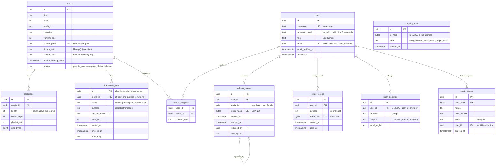
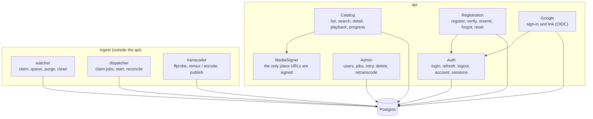
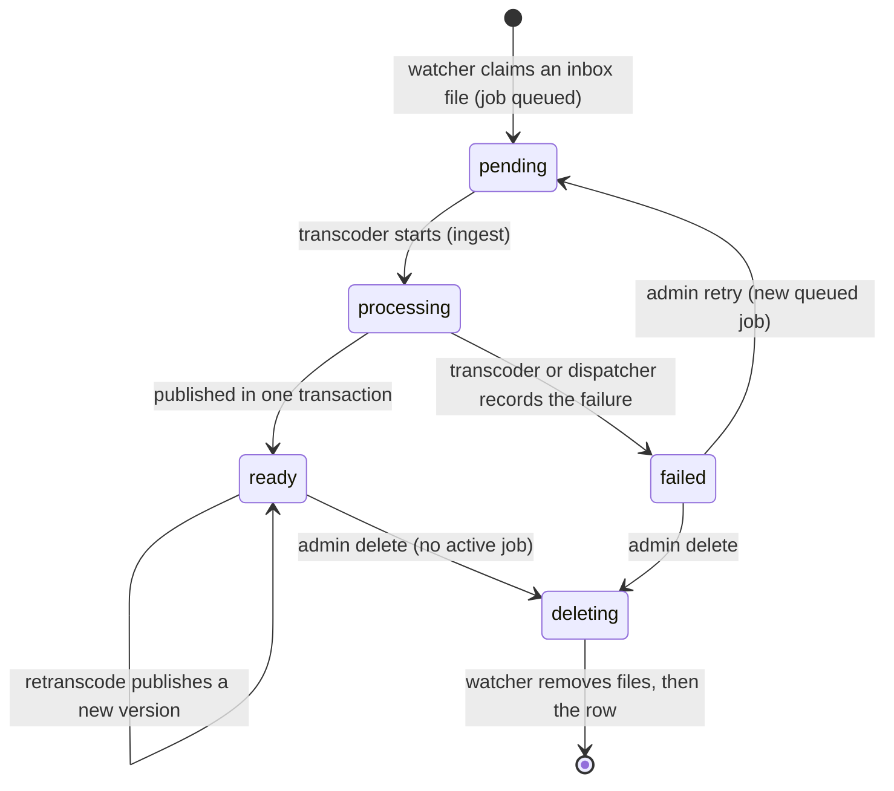
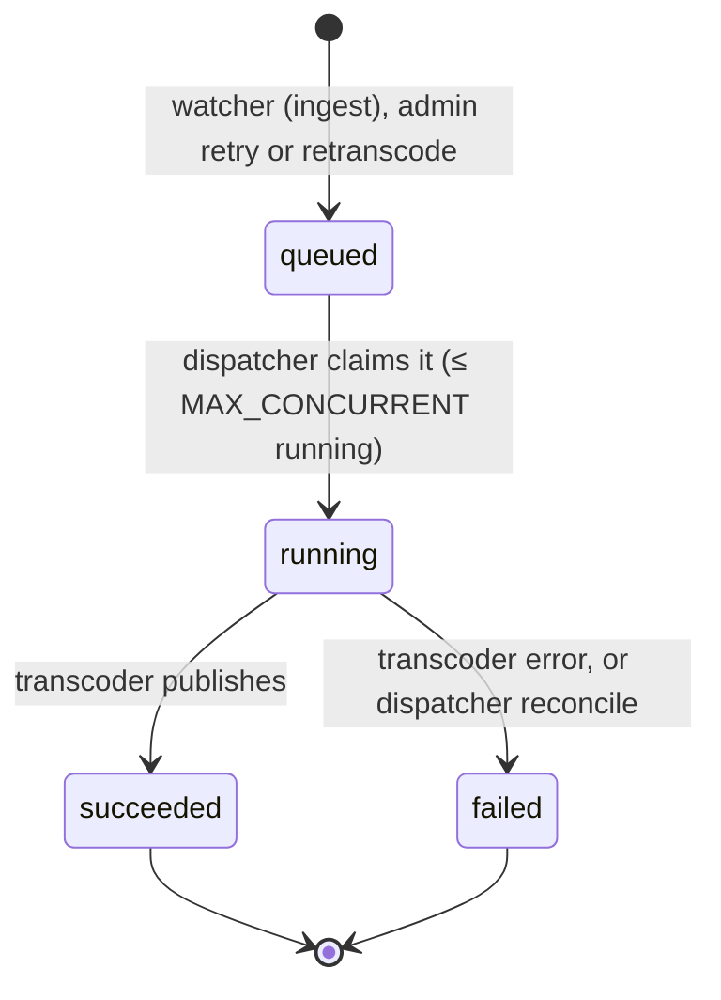

# Logical view

What the system is made of, independent of where it runs: the data, the services that own it,
and the states the two central objects go through.

## Domain model

Every table has a random `uuid` primary key (`gen_random_uuid()`), except `watch_progress`, keyed
by (user, movie). Ids appear in URLs and folder names, so they must not be guessable, and a
string that parses as a UUID cannot contain `../`. Status columns are `text` with a `CHECK`, not
Postgres enums. Every table but `oauth_states` and `outgoing_mail` (both never updated) has
`created_at` / `updated_at`, kept current by one shared trigger.

Notes on the model:

- **Versions.** A publish writes `library/{id}/{version}/` with `version` = the job id;
  `library_path` points at the current one and every playback URL is built from it. Older
  movies keep the original layout (`library_path = library/{id}`). See
  [ADR 0006](decisions/0006-versioned-library-folders.md).
- **Sessions are refresh-token families.** A login creates a family; each refresh inserts a new
  row and revokes the old one (`replaced_by`). Presenting a revoked token revokes the whole
  family. There is no sessions table: a session is a family with a live token. See
  [ADR 0004](decisions/0004-refresh-token-families.md).
- **Secrets are stored as hashes only**: passwords as argon2id, every token (refresh, email,
  OAuth state) as SHA-256, mail recipients as SHA-256 of the address.
- **One active job per movie** is enforced by the database: a partial unique index on
  `transcode_jobs (movie_id) WHERE status IN ('queued', 'running')`.
- **Cleanup.** The watcher deletes refresh-token families with no live token for 7 days, email
  tokens used or expired 7 days ago, and expired OAuth states. `outgoing_mail` prunes itself
  (rows older than 2 days) on every send.

## Services

The api is a set of services behind thin HTTP handlers. None of them touches files or has any
Kubernetes permission; file work belongs to the watcher and the transcoder.

| Service | Owns | Key rules |
|---|---|---|
| **Catalog** | movies as users see them, playback, watch progress | users see `ready` movies only; playback returns signed URLs (6 h) and the saved position (null when ≥ 95 % watched); progress is always the token's user, never the body's |
| **Auth** | login, refresh, logout, the caller's account and sessions | access token 15 min (HS256, carries `sid` = family), refresh cookie 30 days, rotating; per-username+IP and per-IP throttles; endpoints that manage sessions or credentials re-check in the database that the caller's family is still live |
| **Registration / recovery** | sign-up, email verification, forgot / reset password | the same answer whether or not an address has an account; mail sent in the background; Turnstile fails closed; tokens single use, carried in the URL fragment |
| **Google sign-in** | sign-in and linking with Google (OIDC code flow + PKCE) | the Google account is identified by `sub` only; a verified local account with the same email is linked, an unverified one is replaced. See [ADR 0008](decisions/0008-google-identity-by-sub.md) |
| **Admin** | users (disable, role), jobs, movies (retry, delete, retranscode) | the role is checked in the database on every call; never zero active admins; every action logged |
| **Ingest** | the media pipeline: watcher → dispatcher → transcoder | pre-transcoded HLS, remux when the codec allows, never upscale. See [ADR 0001](decisions/0001-pre-transcoded-hls.md) |

## Movie states

A `ready` movie never leaves `ready` because of a retranscode: it keeps playing its current
version, and switches to the new one in the transaction that publishes it. A `deleting` movie is
hidden from every non-admin endpoint at once; the watcher removes `library/{id}/`, then the
source, then the row (renditions, jobs and progress cascade).

## Job states

The dispatcher marks a running job failed when its transcoder exited without recording a
result, is gone, or ran past the 6 h deadline. Every write is guarded on the job still being
`running`, so whichever reports first wins and the other is a no-op.
