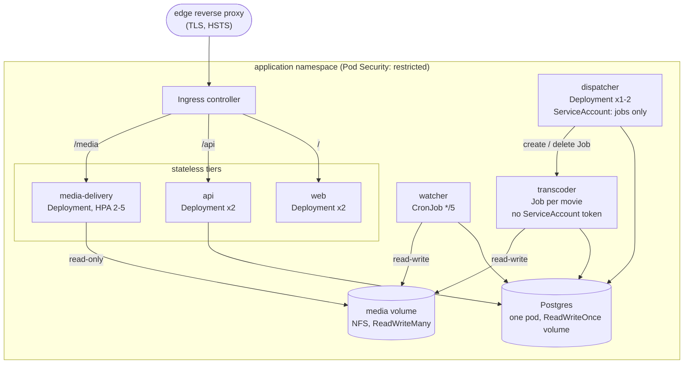
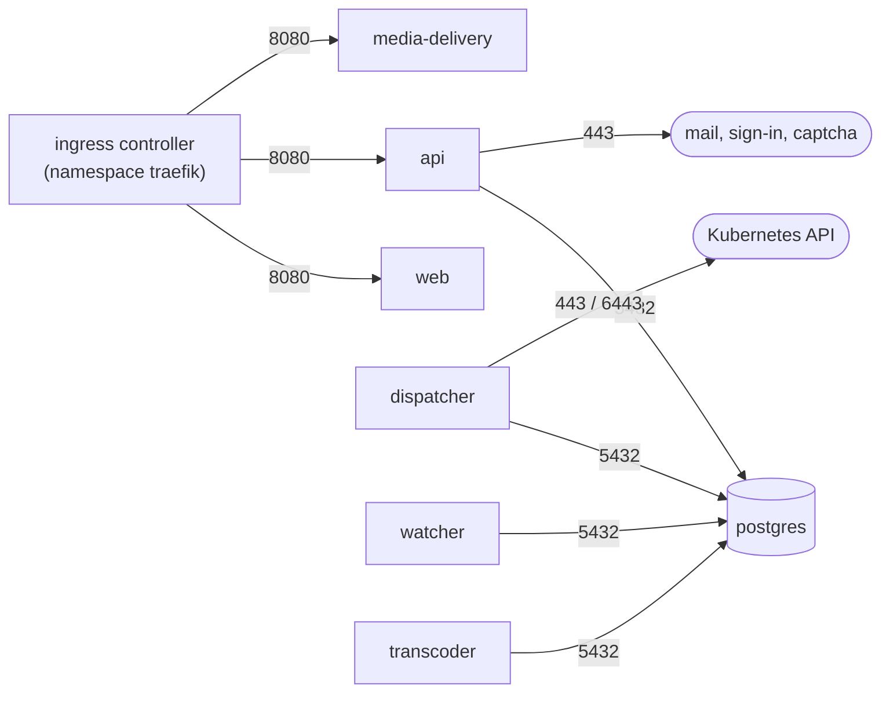
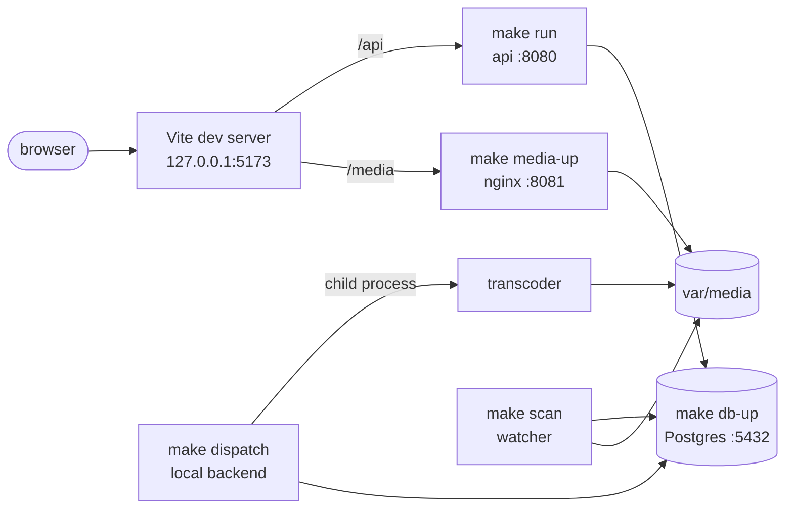

# Physical view

Where the processes run and how they scale. The manifests are Kustomize under
[`deploy/`](../../deploy/): [`deploy/base/`](../../deploy/base/) holds every workload, the same for
every environment, and [`deploy/overlays/local/`](../../deploy/overlays/local/) runs it on a local
kind cluster (`make kind-up`, proved by `make kind-smoke`). This view describes the deployment,
the differences between the local cluster and production, and the local setup without Kubernetes.

## Kubernetes

| Workload | Manifest | Kind | Replicas | Storage | Probes |
|---|---|---|---|---|---|
| web | [web.yaml](../../deploy/base/web.yaml) | Deployment (nginx serving the built SPA) + metrics exporter sidecar | 2 | none | `/healthz`, `/readyz` |
| api | [api.yaml](../../deploy/base/api.yaml) | Deployment, init container `migrate up` | 2 | none | `/healthz`, `/readyz` (Postgres) |
| media-delivery | [media-delivery.yaml](../../deploy/base/media-delivery.yaml) | Deployment + HPA (CPU 70 %) + metrics exporter sidecar | 2–5 | media volume, read-only | `/healthz`, `/readyz` (the mount is readable) |
| dispatcher | [dispatcher.yaml](../../deploy/base/dispatcher.yaml) | Deployment, its ServiceAccount and Role | 1–2 | none | `/healthz`, `/readyz` (Postgres) |
| watcher | [watcher.yaml](../../deploy/base/watcher.yaml) | CronJob, every 5 min, Forbid | one run at a time; overlapping runs would be safe | media volume | none: logs and exit code |
| transcoder | built in code (`internal/dispatch`) | Job, created by the dispatcher | ≤ `MAX_CONCURRENT` | media volume | none: logs and exit code |
| Postgres | [postgres.yaml](../../deploy/base/postgres.yaml) | StatefulSet (Postgres 16) | 1 | ReadWriteOnce volume | `pg_isready` |

### Why the tiers are stateless

All state is in Postgres, so web, api and media-delivery can be scaled, rolled or restarted
freely. media-delivery in particular checks URL signatures with a shared key
(`secure_link_md5`), never calls the api, holds no session and writes nothing. It is the tier
that scales horizontally under viewer load. It serves static files only: no live transcoding,
ever. See [ADR 0001](decisions/0001-pre-transcoded-hls.md) and
[ADR 0003](decisions/0003-signed-urls-stateless-delivery.md).

### Liveness vs readiness

- `/healthz` is **liveness**: the process answers. It checks no dependency. If it checked
  Postgres, one database blip would make Kubernetes restart every api pod at once, and the
  restart would fix nothing.
- `/readyz` is **readiness**: the dependencies this pod needs to serve. Failing it takes the
  pod out of the Service until it recovers, without a restart. Movies already playing keep
  playing, because media-delivery never needs the database.

### Jobs, permissions and the shared volume

- The **dispatcher** is the only component with RBAC: create, get, list, watch and delete on
  `jobs` in its namespace, and the only pod with a ServiceAccount token. The api has no
  Kubernetes permission at all.
- A **transcoder Job** is built in code, so everything in its spec comes from the dispatcher's
  environment:
  - resources;
  - a dedicated ServiceAccount with no RBAC and no mounted token;
  - `backoffLimit: 0`, a 6 h `activeDeadlineSeconds`, `ttlSecondsAfterFinished`;
  - the image pinned by digest;
  - `DATABASE_URL` from a `secretKeyRef`, never copied into the spec.
- The **media volume** is NFS, `ReadWriteMany`: transcoders and the watcher write it,
  media-delivery mounts it read-only. There are no `hostPath` volumes (Pod Security `restricted`
  rejects them).
- **Containers**:
  - non-root, all capabilities dropped, read-only root filesystem;
  - every HTTP container listens on `8080` (named port `http`);
  - images pinned to a patch version, plus the digest in manifests;
  - every image runs as UID 65532; the Go images are distroless (no shell), the web and
    media-delivery images are unprivileged nginx (see
    [the development view](development.md#container-images));
  - secrets reach the cluster encrypted (SOPS) and are applied by GitOps (Flux).

### Network policies

[networkpolicies.yaml](../../deploy/base/networkpolicies.yaml): default deny, ingress and egress,
then only the paths the system uses.

Every pod may also resolve names through kube-dns. Prometheus scraping is added with
monitoring. Destinations outside the cluster are given by port only: the api's providers have
no fixed addresses and the API server's differs per cluster.

### The request chain and client addresses

A request passes an edge reverse proxy (TLS, HSTS), a tunnel and the cluster's ingress
controller before it reaches the api. Each hop appends what it saw to `X-Forwarded-For`.
`TRUSTED_PROXIES` lists the edge proxy's address as the cluster sees it and the pod CIDR; the
ingress controller must also be configured to trust the edge proxy, or it drops the header. See
[ADR 0009](decisions/0009-client-ip-from-trusted-proxies.md).

## The local cluster and production

| | Local (kind, `deploy/overlays/local`) | Production |
|---|---|---|
| Cluster | one kind node ([`deploy/kind/cluster.yaml`](../../deploy/kind/cluster.yaml)), kindnet CNI | a single-node cluster, Cilium CNI |
| Ingress | Traefik ([`deploy/kind/traefik.yaml`](../../deploy/kind/traefik.yaml)), NodePort mapped to `127.0.0.1:8080` | Traefik behind the edge reverse proxy (TLS) |
| Images | `hls-vod/<name>:dev` from `make images`, loaded into the node, never pulled | from the registry, pinned by digest |
| Media volume | a PVC on kind's local-path class, ReadWriteOnce: one node, so the read-only and read-write mounts share it | NFS, ReadWriteMany |
| Secrets | generated by `make kind-up` (`openssl rand`), piped to kubectl | SOPS-encrypted, applied by Flux |
| Mail, registration, Google | none: `MAIL_BACKEND=none`, `REGISTRATION_OPEN=false`, Google off | Resend, Turnstile, Google |
| `TRUSTED_PROXIES` | kind's pod CIDR | the edge proxy's address as the cluster sees it, and the pod CIDR |
| NetworkPolicy | enforced by kindnet; `make kind-smoke` checks it | enforced by Cilium |
| HPA metrics | metrics-server ([`deploy/kind/metrics-server/`](../../deploy/kind/metrics-server/)), `--kubelet-insecure-tls` | metrics-server with verified kubelet certificates |

## Local development without Kubernetes

Everything listens on `127.0.0.1` only: Postgres and nginx are published on loopback by
docker compose, and the api defaults to `127.0.0.1:8080`. The local dispatcher backend starts
the transcoder as a child process instead of a Kubernetes Job.
