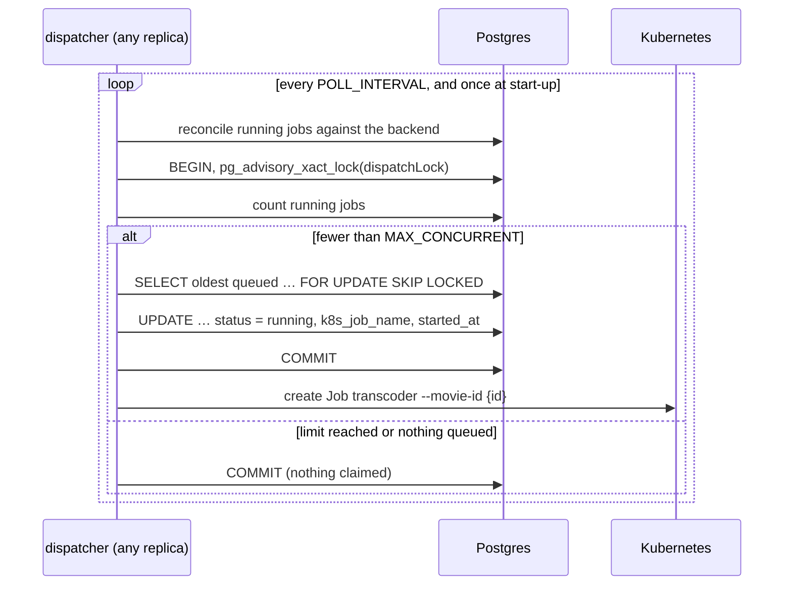
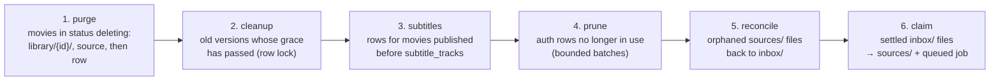
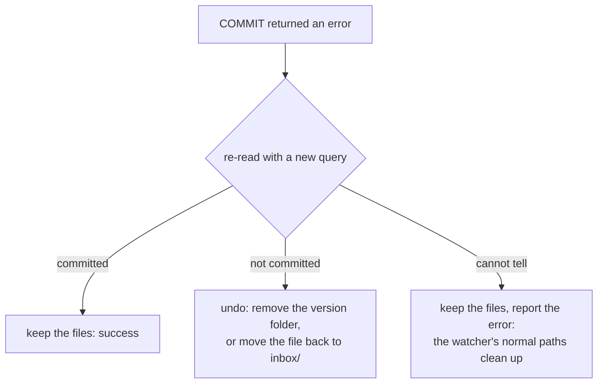
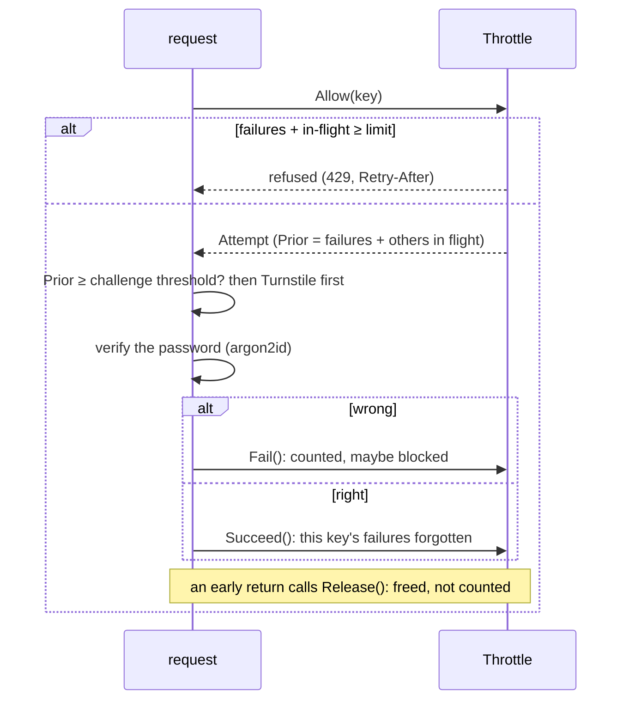

# Process view

What runs concurrently, and the mechanism that keeps each shared step correct. The rule of thumb
throughout: **the database decides who wins**, through row locks, advisory locks, conditional
updates and unique indexes, never through timing.

## The running processes

| Process | Lifetime | Concurrency |
|---|---|---|
| `api` | long-running, 2+ replicas | any number of requests at once; argon2id limited to 2 hashes per process |
| `web` | static files (nginx) | stateless |
| `media-delivery` | long-running nginx, 2–5 replicas (HPA) | stateless: checks signatures itself, never calls the api |
| `dispatcher` | long-running, 1–2 replicas | ticks every `POLL_INTERVAL`; replicas coordinate through Postgres |
| `watcher` | one scan per run (CronJob, every 5 min) | runs may overlap; every step is safe to run twice |
| `transcoder` | one Kubernetes Job per claimed job | up to `MAX_CONCURRENT` at once, one per movie |

## Dispatcher: claiming jobs

- The **advisory lock** makes "count the running jobs, then claim one" a single atomic step
  across replicas, so `MAX_CONCURRENT` is exact.
- **`FOR UPDATE SKIP LOCKED`** means a row another transaction holds is skipped, not waited
  for; two replicas never claim the same job.
- **Reconcile** (every tick, and at start-up, which is what makes a dispatcher restart safe)
  compares each running row with the backend. A transcoder that exited without a result, one
  that is gone, or one past its 6 h deadline is marked failed (the deadline also stops it). A
  transcoder that is still running is left alone, never started twice.
- **Sweep** deletes Kubernetes Jobs labelled `app=transcoder` that no row knows about.
- The dispatcher is the only component with permission to create Jobs. Its backends: a
  Kubernetes Job (client-go, in-cluster), or a local child process for development.

## Watcher: one run

Each run does six steps, in this order. Every step tolerates a second run doing the same work
at the same time.

- **Purge before reconcile.** A deleted movie's row is removed only after its source file, so
  reconcile never sees that source without a row and never sends it back to be ingested again.
- **Cleanup** handles movies whose `library_cleanup_after` has passed and that have no active
  job. It runs under the movie's row lock and re-checks those conditions inside it. A
  retranscode cannot be queued (it takes the same lock) or published (its transaction updates
  that row) while files are being removed. It keeps only the current version folder.
- **The rename is the claim lock.** Moving `inbox/x.mkv` to `sources/{id}.mkv` is atomic: of two
  runs, exactly one rename succeeds. The rename happens inside the transaction that inserts the
  movie and its job, under a *shared* advisory lock.
- **Reconcile** takes the same advisory lock *exclusively* (try-lock). If any claim is between
  rename and commit, reconcile skips this run. So "a file in `sources/` with no row" really
  means a crash, never a claim in progress. Such files go back to the inbox once they are old
  enough.
- **Subtitles** reads the `subs/` folder of the current version of every ready movie that has
  no subtitle rows, and writes them under the movie's row lock, only if `library_path` is still
  the one it read. A retranscode publishing meanwhile wins; a second run finds nothing to do.
- **Prune** deletes at most 1000 rows per batch and 10 batches per table per run.

## Transcoder: job mode

`transcoder --movie-id {id}` is what the dispatcher starts.

1. `StartTranscode`: the job must be `running`. For an ingest the movie goes to `processing`;
   for a retranscode it stays `ready`.
2. A retranscode first checks free space (1.5 × the current version).
3. The output is written into `library/{id}/.{version}.partial-*`, then renamed to
   `library/{id}/{version}/` in one atomic step.
4. `FinishTranscode`: one transaction writes the renditions, the movie's paths and runtime,
   and `succeeded`. For a retranscode it also sets `library_cleanup_after` = now + the
   old-version grace (25 h).
5. On any failure: the job is marked failed with its error. An ingest movie is failed too; a
   retranscoded movie stays `ready` on its current version.

The final write runs on a context that SIGTERM does not cancel, so an interrupted transcode is
still recorded as failed.

## Ambiguous commits

A `COMMIT` that returns an error may still have succeeded: the server committed, and the
connection broke before the answer arrived. Before undoing any file work that went with a
transaction, the program asks again with a new query.

| Who | Re-read | Committed | Cannot tell |
|---|---|---|---|
| transcoder | job succeeded and `library_path` = this version | keep the folder, report success | keep the folder; failing the job sets `library_cleanup_after`, so cleanup removes any folder the movie does not play |
| watcher (claim) | a movie row exists for that source | keep the file in `sources/`, count it as claimed | keep the file; with no row, reconcile returns it to the inbox once it is old enough |

## Throttles with in-flight reservations

Failed logins are counted in memory per api process: per username + client IP (5 failures in
15 min → 429 for 15 min; Turnstile from the 3rd), and per client IP across all usernames
against password spraying (Turnstile from 10, 429 from 100). Password checks on the account
page are throttled per user id.

An attempt is **reserved** before the expensive work (the argon2id hash) and counts against the
limit until it ends:

So a burst of parallel wrong passwords cannot all pass the check before the first failure is
recorded: at most `limit − failures` of them are in flight at once. The client IP comes from one
resolver (`internal/clientip`), which believes `X-Forwarded-For` only through trusted proxies.
See [ADR 0009](decisions/0009-client-ip-from-trusted-proxies.md).

## Refresh across tabs

Every tab shares one refresh cookie, and each refresh rotates it. If two tabs refreshed at once,
the second would present an already-rotated token. That is reuse, and it revokes the whole
session family. The SPA prevents this:

- **single-flight within a tab**: one refresh promise, shared by every caller;
- **a Web Lock across tabs**: only the tab holding the lock refreshes. A second tab waits for
  the lock, then sends the cookie the first one received, so both stay logged in. Without
  Web Locks (outside a secure context) refresh is single-flight within each tab only;
- never during `pagehide`: the page could die after the server rotated the cookie but before
  the browser stored the new one.

A request that replaces the session (a password change) runs under the same lock.

## Last admin

Demoting or disabling an admin must never leave zero active admins, even when two admins act at
once. The transaction locks every active admin row **in id order** (`FOR UPDATE ORDER BY id`),
then the target. It checks "would this remove the last active admin?" while holding all of
those locks. Two concurrent demotions serialise on the same rows in the same order, so the
second one sees the first one's result and gets `409 last_admin`. Changing your own role or
status is refused outright (`409 self_change`).

## Liveness vs readiness

Every long-running service exposes `/healthz` (liveness: process only, no dependencies) and
`/readyz` (readiness: Postgres for the api and dispatcher, a readable media mount for
media-delivery). A database outage therefore takes pods out of the Service without restarting
them all at once. Run-to-completion workloads (transcoder, watcher) have no probes; they report
through logs and their exit code.
