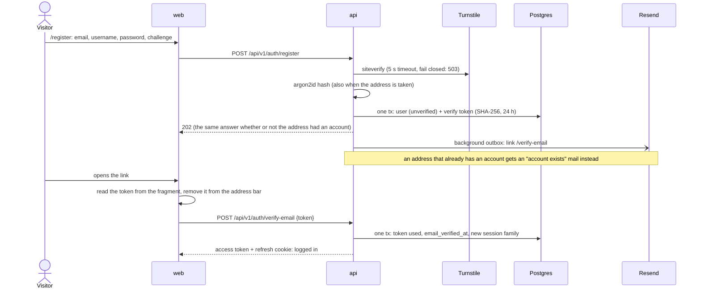
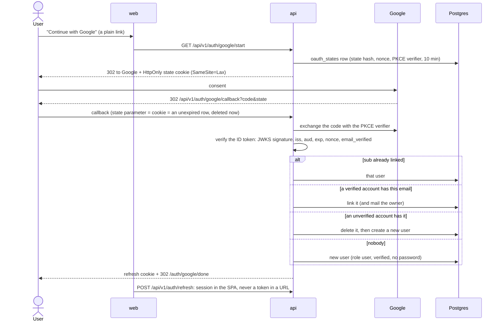
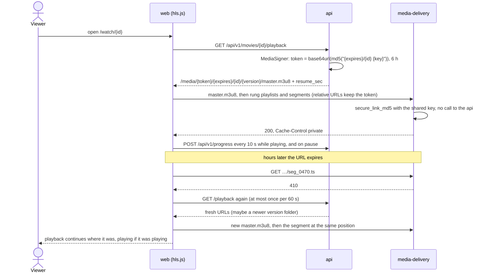
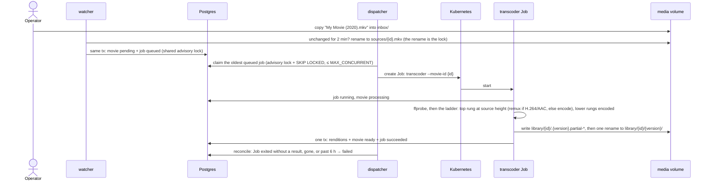
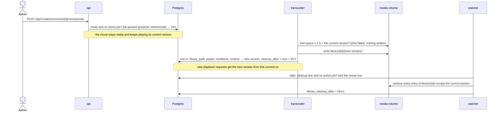
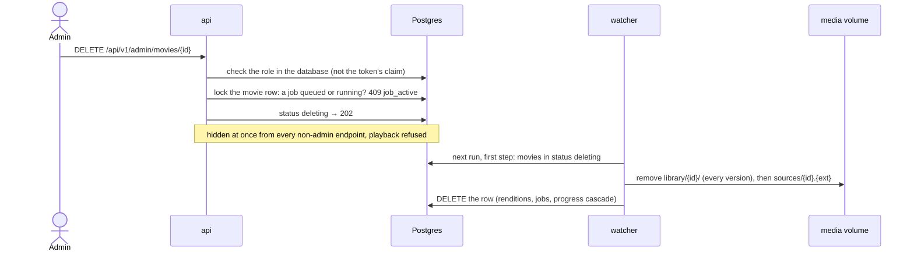

# Scenarios (+1)

The flows that matter most, end to end. Each one touches several views: the logical states, the
process guarantees, and the physical tiers.

## Register and verify the email

- **No enumeration.** Register, resend and forgot-password give the same answer for every
  address, and do the same work. Mail goes out in the background, so timing tells nothing.
- **Rate limits.** At most 3 mails per address per hour, and a daily cap across replicas
  (recorded before sending, under an advisory lock). 10 attempts per hour per client IP.
- **Email cannot change.** It is fixed at registration, because it is the recovery channel and
  the key for linking Google. See [ADR 0007](decisions/0007-email-fixed-at-registration.md).
- **Squatting is bounded.** An unverified account with no live verify token is deleted by the
  next registration that wants its email or username.

## Sign in with Google

The Google account is identified by its `sub` only, never its email. A later change of the Google
address changes nothing locally. See [ADR 0008](decisions/0008-google-identity-by-sub.md).

## Play a movie, across an expired URL

- **403 vs 410.** A wrong, tampered or malformed token is 403 and is never retried; only 410
  (a valid token that has expired) triggers a renewal.
- **One token per movie folder.** The token covers `library/{id}/`, so it also covers every
  version folder in it, and hls.js's relative URLs inherit it from the path.
- **Posters.** A poster that fails to load makes its page refetch its data once, to pick up
  fresh signed URLs.
- See [ADR 0003](decisions/0003-signed-urls-stateless-delivery.md).

## Ingest a new movie

The top rung never exceeds the source resolution (a 720p source gets a 720p top rung). Posters,
thumbnail sprites and subtitles are produced in the same run. See
[ADR 0001](decisions/0001-pre-transcoded-hls.md) and
[ADR 0005](decisions/0005-postgres-job-queue-kubernetes-jobs.md).

## Retranscode a ready movie

The 25 h grace is derived in code from the longest signed URL lifetime (posters: 24 h, rounded
up), so no URL issued for the old version outlives its files. A failed retranscode leaves the
movie `ready` on its old version. See
[ADR 0006](decisions/0006-versioned-library-folders.md).

## Admin deletes a movie

The row goes last. While it exists, reconcile treats the source as claimed and never sends it
back to the inbox. The api never touches the files itself.
